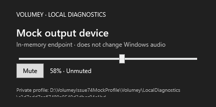

# Issue #74 visual evidence attempt

This evidence-only branch records the isolated diagnostic-spider attempt for PR #116. The image below is the spider's mock endpoint panel only. It is **not** the production Volumey mixer and does not show popup mode.

## Observed state

- Diagnostic process ready: yes
- Endpoint: in-memory `Mock output device`
- Volume: 58%
- Muted: no
- Profile: isolated temporary profile
- Live Windows audio accessed: no

## Limitation

The diagnostic startup handles `--local-diagnostics` before the normal application startup and returns after creating a separate WPF window. That window has only a mock volume slider and mute button; it does not instantiate the production mixer view or read `Window.PopupMode`. It therefore cannot represent or verify a production cold launch in popup mode. No before/after production mixer screenshots were captured.

The screenshot is a WPF visual render of the diagnostics window, not evidence about native or GPU-hosted surfaces. No diagnostic-spider source or product code is included on this branch.

## Temporary verification setup

- Disposable checkout based on PR #110 head `63e11f1f7f241bdab67f447a37bb9670288bed4c`.
- PR #116 feature commit `d40ea6b232532d4ca817a5732444bd602fd97309` was cherry-picked into that temporary checkout only.
- The isolated app build passed with 0 warnings and 0 errors.
- The evidence branch itself is based on upstream `main` and contains only this note and the screenshot.
